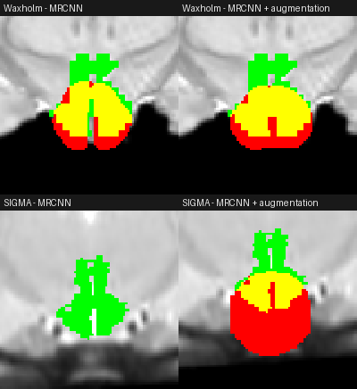

# Public-data test

Trained Mask R-CNN models run on two public rat brain templates, each resampled into CAMRI's
scan geometry, scored against the template's own hypothalamus label (median over 3 views).
See `public_atlas_test.py` for how the images were made and the limits of this test.

| Public brain | Model | Dice | IoU |
|---|---|---|---|
| Waxholm (ex vivo) | Mask R-CNN | 0.66 | 0.49 |
| Waxholm (ex vivo) | Mask R-CNN + augmentation | 0.61 | 0.44 |
| SIGMA (in vivo T2) | Mask R-CNN | 0.20 | 0.11 |
| SIGMA (in vivo T2) | Mask R-CNN + augmentation | 0.37 | 0.22 |

For comparison, on CAMRI's own hand-traced rats: Mask R-CNN Dice 0.74 / IoU 0.59; + augmentation 0.72 / 0.56 (see `RESULTS.md`).

Yellow = agreement, red = model only, green = label only (first view of each brain).

**Reading it:**
- **Waxholm** is a fair test: an unseen brain, scanned differently (ex vivo). Dice 0.66 against 0.74 on CAMRI is solid
  generalization. Most of the green is the tall upward extension that Waxholm's label includes and the model doesn't draw.
- **SIGMA** draws its hypothalamic region as a narrow, tall column, a different shape from Waxholm's and from NUDZ's
  traces, so its low scores mostly reflect that difference in definition. It isn't an accuracy test.
- **Augmentation adds robustness:** on SIGMA the baseline detects the structure on 1 of 4–5 slices, the augmented
  model on 3–4.
